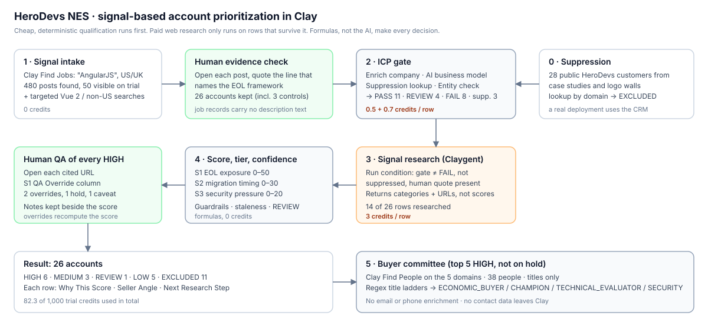
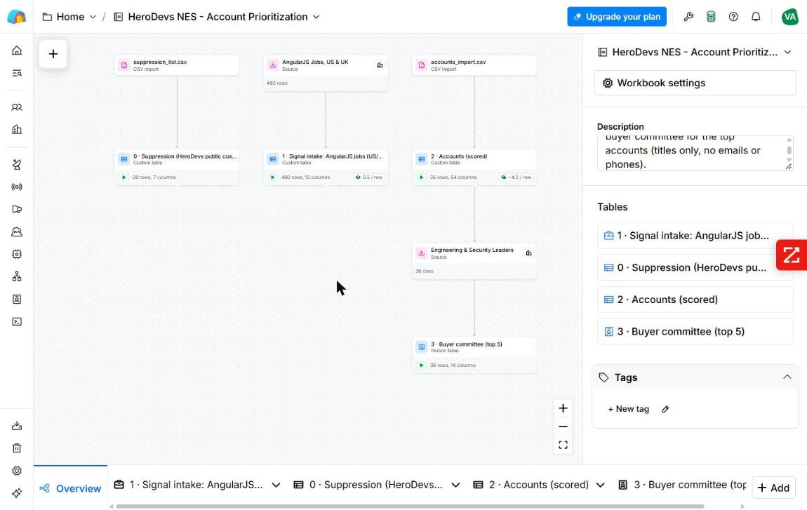
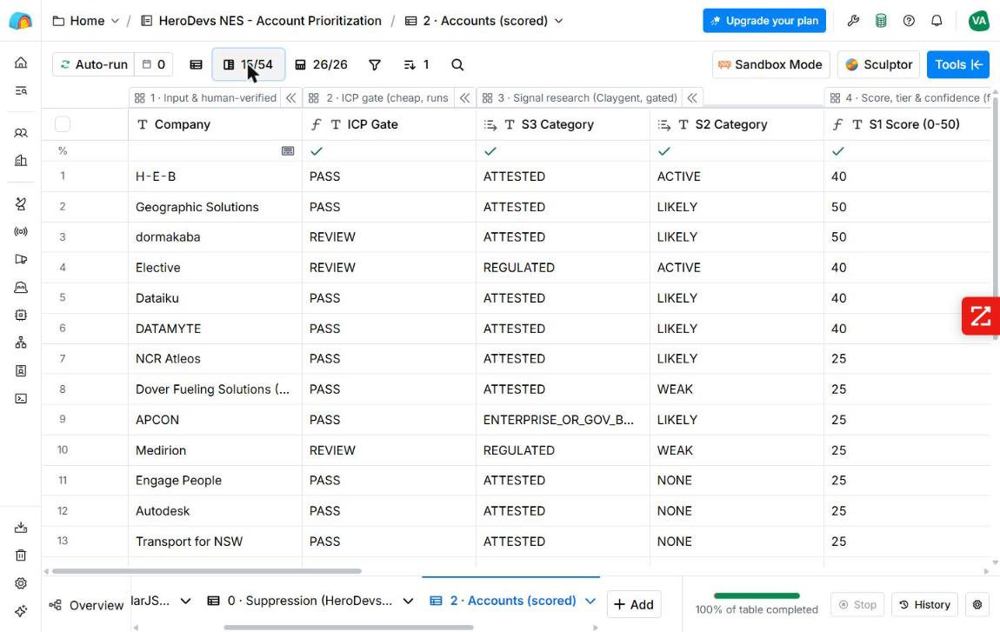
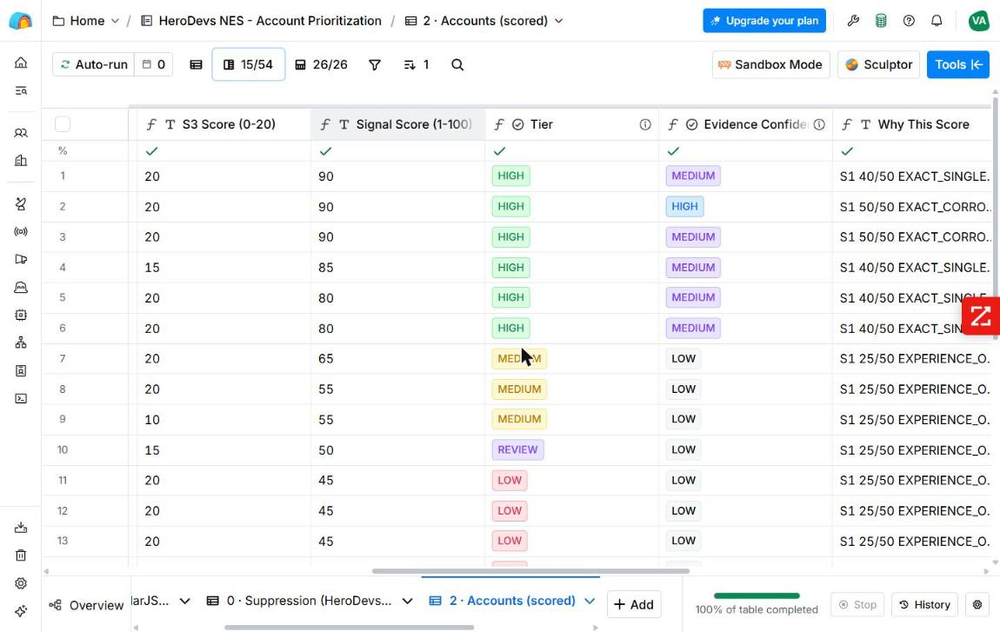

# Clay architecture

## Workbook: `HeroDevs NES - Account Prioritization`

| Table | Rows | Purpose |
|---|---|---|
| `0 · Suppression (HeroDevs public customers)` | 28 | CSV import of public case-study and logo-wall customers |
| `1 · Signal intake: AngularJS jobs (US/UK)` | 480 found, 50 visible on trial | Clay Find Jobs source; keyword AngularJS, posted in the last 120 days |
| `2 · Accounts (scored)` | 26 | The decision table: 54 columns in 6 groups |
| `3 · Buyer committee (top 5)` | 38 | Clay Find People, fed by the `Committee Domain` column of table 2 |

## Column groups in `2 · Accounts (scored)`

| Group | Columns | Cost |
|---|---|---|
| **1 · Input & human-verified evidence** | Company, Domain, LinkedIn, Cohort, Source, Intake job title / URL / date, S1 evidence quote, Research date | 0 |
| **2 · ICP gate (cheap, runs first)** | Enrich company → Name, Employees, Industry, Description …; Business Model (AI); Suppression lookup; Suppressed; Entity Check; ICP Gate; ICP Rationale; Evidence Age | 1.2/row |
| **3 · Signal research (Claygent, gated)** | EOL Tech Evidence (Claygent) → S1 Level, S2 Category, S3 Category, Contradiction, S1 Corroboration URL | 3/row, only on rows that pass the run condition |
| **4 · Score, tier & confidence (formulas)** | S1/S2/S3 Score, Signal Score, Tier (colored Select), Evidence Confidence (colored Select), Why This Score | 0 |
| **5 · Seller action** | Seller Angle, Next Research Step | 0 |
| **6 · QA, overrides & committee handoff** | Evidence Notes, S1 QA Override, QA Note (human), S1 Final, Committee Domain | 0 |

A second view, **Seller view (scored, key columns)**, shows 15 of the 54 columns, sorted by score.

## Design rules

1. **Cheap before expensive.** The gate costs 1.2 credits per row. The 3-credit Claygent column has a run condition, so FAIL rows, suppressed rows and rows without verified evidence are never researched.
2. **The AI interprets, the formulas decide.** Claude classifies the business model, and Claygent classifies evidence into fixed categories. Every number, tier and exclusion comes from a formula you can read.
3. **Auto-run is off on every paid column.** Runs are started by hand, first on 1–2 rows, then on the gated set.
4. **The human layer is a column, not a side channel.** `S1 QA Override` → `S1 Final` → score. A correction re-scores the row and stays visible as "(QA override)" in `Why This Score`.
5. **No contact enrichment before qualification.** Table 3 holds titles only.

## Credit-efficiency review

Trial allowance: 1,000 data credits every two weeks. **Used: 82.3** (1,000 → 917.7, read from the workspace credit meter).

| Step | Rows | Unit cost | Credits | Note |
|---|---|---|---|---|
| Find Jobs intake | 480 found | free | ≈ 5 | Saving the source table |
| Enrich company | 26 (25 found) | 0.5 | ≈ 12.5 | |
| Business Model (Claude Sonnet) | 24 charged | 0.7 | ≈ 16.8 | 2 rows had empty inputs and were not charged |
| Claygent signal research | 16 runs on 14 rows | 3 | 48 | Includes 2 re-runs (6 credits) after the prompt and schema fix |
| Lookups, formulas, Find People (38), template | — | 0 | 0 | |
| **Total** | | | **82.3** | |

**Cost per outcome:** about 13.7 credits per HIGH account, and 5.9 per researched account.

**What was not spent, on purpose:**

| Avoided | Would have cost |
|---|---|
| Claygent on all 26 rows instead of the 14 gated rows | +36 |
| Work email for 38 committee members | ≈ 23–42 |
| Latest-funding enrichment (5.7/row) | ≈ 150 |
| Tech-stack waterfall (≈ 2/row) | ≈ 52 |
| A model mix-up: a mis-click selected Claude Opus (6/row) instead of Sonnet (0.7/row) for the business-model column; caught before running | ≈ 138 |

**Waste that did happen:** 6 credits. The first JSON-schema setup did not save, so 2 rows came back as unstructured text, and one of them had cited a personal profile. Both rows were re-run after the fix.

**At scale (estimate):** 1,000 intake posts → ~75% staffing or services noise, so about 250 company rows. Gating them costs 1.2 × 250 = 300. If ~45% pass with verified evidence, ~110 rows get Claygent at 330. **About 630 credits per 1,000 posts**, before any contact spend. The expensive step at scale is the human evidence read, not credits. See [DEVILS_ADVOCATE.md](DEVILS_ADVOCATE.md).

## Template

**Workbook settings → Share as template.** The shared link copies configuration (tables, columns, formulas, prompts, run conditions), not rows. Checked by opening the link: the tables show column counts and no data.

## Platform limits found along the way

- The Find Jobs trial shows 50 of N rows, and the exclude-company filter needs an upgrade.
- Find Jobs records carry no description text.
- Formulas are expressions only. Statements return `None`.
- Clay has no conditional cell colors. Tier and Confidence use the **Select** output type instead, which colors each value.
- Claygent output is not deterministic. Geographic Solutions was EXPERIENCE_ONLY on one run and EXACT_CORROBORATED on the next.
